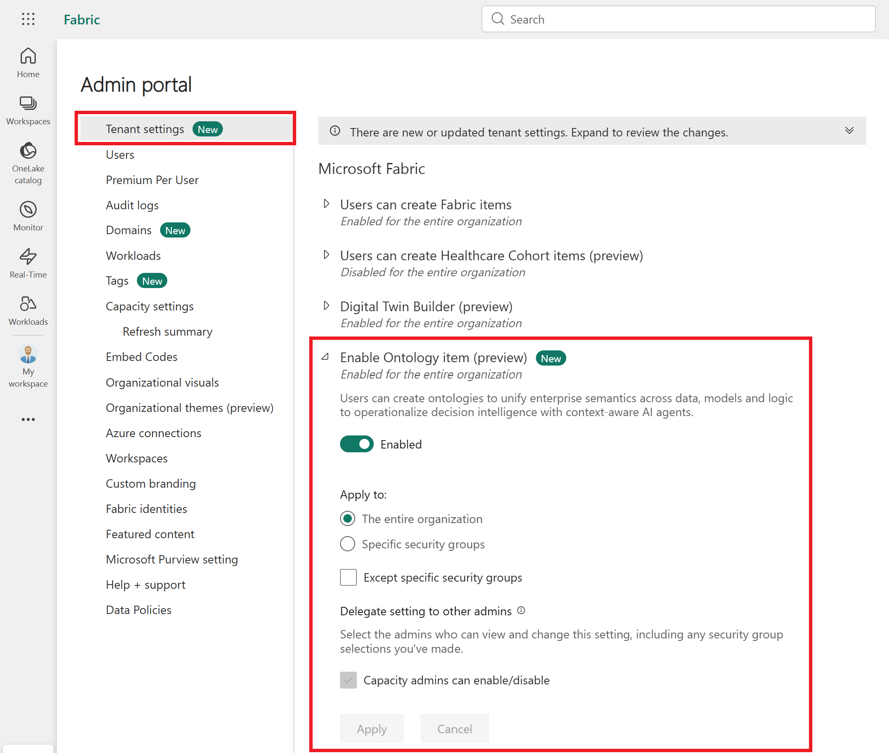
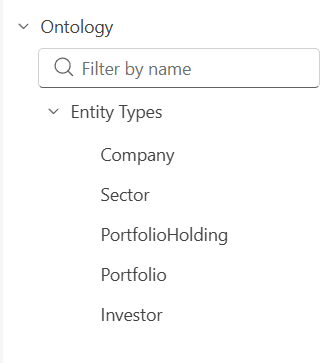
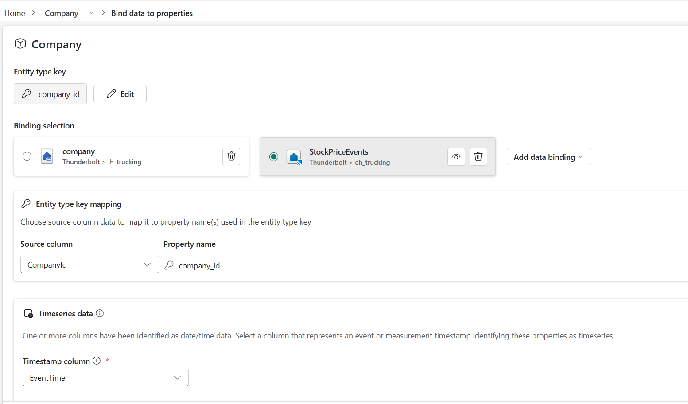

## Stock Ticker Ontology Setup

# Pre-Requisites

This setting is required to create ontology (preview) items: Enable Ontology item (preview).

If you don't enable this setting, you get errors when creating a new ontology item.

# Configuration

* Provision Lakehouse instance - Create Lakehouse instance with the name lh_stock

* Provision Eventhouse instance - Create Lakehouse instance with the name eh_stock

# Hydrate Data into Lakehouse and Eventhouse

* Import the notebook **01_Lakehouse_Data.ipynb**, attach the lakehouse datasource and execute it

* Import the notebook **02_EventHouse_Data_Generation**, extract the eventhouse URI and update in the notebook and also the database name. This would start generating real-time telemetry for you on the event house

# Ontology Creation

* Create new Ontology resource and then register new entities

* Create new Ontology resource and then register new entities

* For Company Entity, bind both the lakehouse and eventhouse properties

